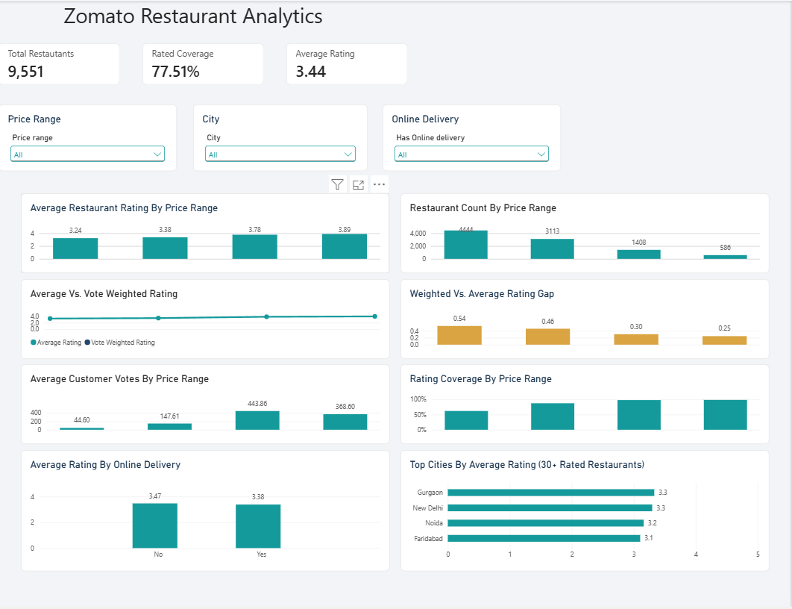

# Zomato Restaurant Analytics

An end-to-end data analytics project exploring restaurant ratings, pricing, customer engagement, cuisine preferences, and service availability using **MySQL and Power BI**.

## Project Overview

This project analyzes restaurant data to identify patterns in customer ratings, restaurant pricing, voting behaviour, and service availability.

The objective is to transform raw restaurant data into meaningful business insights through SQL-based analysis and an interactive Power BI dashboard.

## Business Questions

The analysis investigates the following questions:

1. How do restaurant ratings vary across different price ranges?
2. Which price ranges contain the most restaurants?
3. Is customer engagement (votes) associated with restaurant pricing and ratings?
4. How do ordinary average ratings compare with vote-weighted ratings?
5. Does online delivery availability relate to restaurant ratings?
6. Which cities and cuisine combinations perform well?
7. How does rating coverage vary across price ranges?

## Tools & Technologies

| Tool | Purpose |
|---|---|
| MySQL | Data cleaning, validation, and exploratory analysis |
| SQL | Aggregations, filtering, joins, and business analysis |
| Power BI | Interactive dashboard and data visualization |
| DAX | Measures and calculated metrics |
| Excel / CSV | Dataset inspection and preparation |

## Dataset Overview

- **Working table:** `zomato_clean`
- **Records analysed:** 9,551 restaurants
- **Columns:** 21
- **Unique restaurant IDs:** 9,551

The dataset includes restaurant names, locations, cuisines, average cost, price range, ratings, votes, and service availability.

## Data Cleaning & Validation

The data validation process included:

- Checking total records and unique restaurant IDs.
- Identifying duplicate records.
- Checking missing and blank values.
- Validating numerical fields such as ratings, votes, and average cost.
- Inspecting rating labels and rating colours.
- Checking geographic coordinates.
- Reviewing inconsistent text values.

The final working table contains 9,551 unique restaurant records.

Nine records contain blank cuisine values. These were preserved rather than assigned unsupported cuisine labels.

## SQL Analysis

The SQL scripts are organized into four stages:

| Script | Analysis |
|---|---|
| `01_data_quality_validation.sql` | Data quality and validation |
| `02_ratings_and_price_analysis.sql` | Ratings and price range analysis |
| `03_customer_engagement.sql` | Votes and customer engagement |
| `04_cuisine_city_service_analysis.sql` | Cuisine, city, and service analysis |

See the [`sql/`](sql/) folder for the complete queries.

## Key Findings

### 1. Ratings increase with price range

| Price Range | Restaurants | Average Rating |
|---|---:|---:|
| 1 | 4,444 | 3.24 |
| 2 | 3,113 | 3.38 |
| 3 | 1,408 | 3.78 |
| 4 | 586 | 3.89 |

Higher price ranges have higher average ratings in this dataset. This is an observed association, not evidence that higher prices cause better ratings.

### 2. Rating coverage varies significantly

| Price Range | Rating Coverage |
|---|---:|
| 1 | 61.75% |
| 2 | 87.09% |
| 3 | 97.51% |
| 4 | 98.12% |

Price ranges 1 and 2 account for approximately **97.86% of all unrated restaurants**.

### 3. Customer engagement

Average votes per restaurant vary across price ranges:

| Price Range | Average Votes |
|---|---:|
| 1 | 44.60 |
| 2 | 147.61 |
| 3 | 443.86 |
| 4 | 368.60 |

Price range 3 has the highest average number of votes. Engagement does not increase consistently across every price range.

### 4. Ordinary vs. vote-weighted ratings

Vote-weighted ratings account for the number of votes received by each restaurant.

| Price Range | Ordinary Average | Vote-Weighted Average |
|---|---:|---:|
| 1 | 3.24 | 3.78 |
| 2 | 3.38 | 3.84 |
| 3 | 3.78 | 4.08 |
| 4 | 3.89 | 4.14 |

The weighted averages are higher across all four price ranges. This indicates that restaurants with more votes have a stronger influence on the weighted result.

### 5. Online delivery

- Restaurants offering online delivery have an average rating of 3.38.
- Restaurants without online delivery have an average rating of 3.47.

The difference is relatively small and should not be interpreted as a causal relationship. The two groups also differ in rating coverage and composition.

### 6. City-level observations

Among cities with at least 30 rated restaurants:

| City | Average Rating |
|---|---:|
| Gurgaon | 3.33 |
| New Delhi | 3.30 |
| Noida | 3.16 |
| Faridabad | 3.10 |

The dataset is concentrated in these cities, so the results should not be generalized to all restaurant markets.

## Power BI Dashboard

The interactive dashboard includes:

- Total restaurants, rating coverage, and average rating KPIs.
- Average restaurant rating by price range.
- Restaurant count by price range.
- Ordinary vs. vote-weighted rating comparison.
- Weighted vs. average rating gap.
- Customer engagement by price range.
- Rating coverage by price range.
- Average rating by online delivery.
- City-level rating comparison.

**Dashboard file:** [`Zomato_Dashboard.pbix`](powerbi/Zomato_Dashboard.pbix)

See the [`powerbi/`](powerbi/) folder for the dashboard file and its documentation.

## Limitations

- The analysis describes associations and does not establish causation.
- Blank cuisine values were preserved rather than guessed.
- Some geographic coordinates require further verification.
- The dataset is concentrated in a limited set of cities.
- Vote counts represent recorded engagement, not necessarily unique customers.
- Average ratings exclude restaurants with an aggregate rating of zero.

## Conclusion

The analysis identifies clear differences in restaurant ratings, rating coverage, and customer engagement across price ranges.

Higher price ranges show higher average ratings and more complete rating coverage. Vote-weighted ratings are also consistently higher than ordinary averages, highlighting how customer engagement influences aggregate results.

The project demonstrates an end-to-end analytics workflow using SQL for data validation and business analysis, and Power BI for interactive visualization.

---

**Technologies:** MySQL | SQL | Power BI | DAX | Excel

**Project:** Zomato Restaurant Analytics
